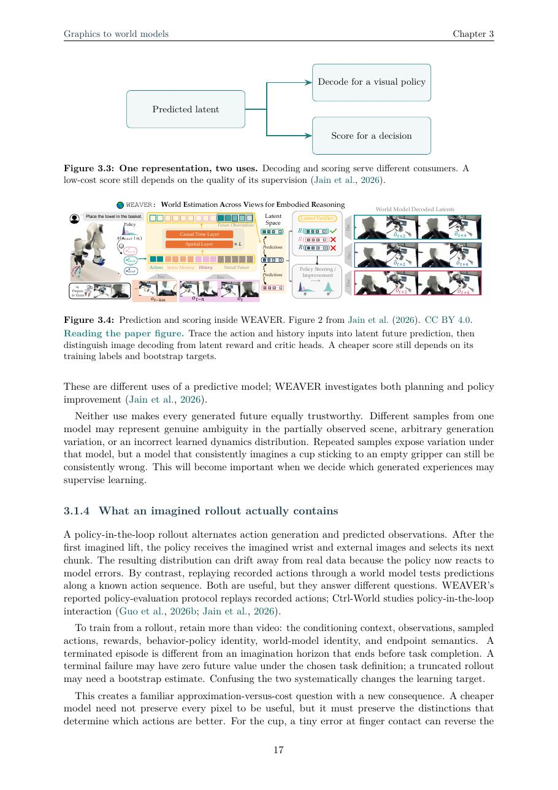

# From Graphics to World Models

By **Bruce.Z@LiftAI**

**How models of the world help robots predict, act, and learn.**

A rendered scene tells us what the world looks like. A robot needs to know what will happen when it acts: whether a grasp will hold, a push will move an object, or a connector will catch on an edge. This book follows the path from scene representations to world models that can guide decisions and learning.

**[Read the book](docs/from-graphics-to-world-model.pdf)**

## Who this book is for

Students and professionals with a background in **computer graphics, physics, mathematics, or a related quantitative field** who want to move into **robotics, particularly world models for robot learning**. The aim is to connect familiar ideas to current research and help you choose what to study or investigate next.

You should know linear algebra, multivariable calculus, probability, basic machine learning, and Python at roughly third-year undergraduate level or above. Equivalent experience from work or self-study is welcome. No previous robotics experience is required.

## What you will learn

1. **From images to predictions:** what changes when a scene representation must predict the consequences of an action.
2. **Policies and demonstrations:** how robots generate continuous movements and adapt to a demonstrated task.
3. **Learning from experience:** how rewards, values, and policy gradients turn outcomes into updates.
4. **Controllable world models:** why action conventions, memory, geometry, and contact matter.
5. **Evaluating improvement:** how to tell a convincing prediction from a useful decision or better behavior.
6. **Choosing a research direction:** how to turn an open question into an experiment you can interpret.



*WEAVER architecture: Jain et al. (2026), Figure 2, CC BY 4.0.*

## Try an experiment

The accompanying Python example explores how a change in an object's response can make a previously accurate model choose poor actions. It runs on a laptop with Python 3.9 or later, without additional packages:

```sh
python3 examples/one_dimensional_world.py --output results/toy
```

Chapter 6 explains the model, results, and possible extensions.

Corrections and questions are welcome in [Issues](https://github.com/BBBBBbruce/From-Graphics-to-World-Model/issues).

---

Original text and diagrams: [CC BY-NC 4.0](LICENSE-book.txt). Code: [MIT](LICENSE-code). Reproduced paper figures retain their credited licenses; see [figure credits](FIGURES.md).
